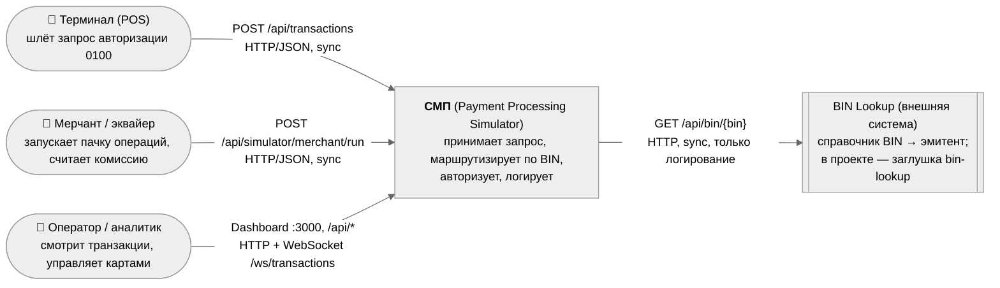

# A1. C4 Context — граница СМП и внешний мир

| Утверждение | Доказательство в коде |
|---|---|
| Единая точка входа для запросов — Gateway, маршрут `POST /api/transactions` → Switch `/api/internal/route` | [gateway `application.yml`, route `switch`](../../../services/gateway/src/main/resources/application.yml) |
| Валидация входного сообщения (mti `0100`, PAN 16 цифр, amount > 0, currency 3 символа, mcc 4 цифры) на границе системы | [`TransactionRequestValidator`](../../../services/gateway/src/main/java/com/processing/gateway/validation/TransactionRequestValidator.java) |
| Терминал — симулятор, ходит в Gateway | [`AppConfig` terminal-simulator, `gateway.url`](../../../services/terminal-simulator/src/main/java/com/processing/terminalsimulator/config/AppConfig.java) |
| Мерчант/эквайер шлёт операции через Gateway и сам отдаёт комиссию | [`GatewayClient`](../../../services/merchant-acquirer/src/main/java/com/processing/merchantacquirer/client/GatewayClient.java), [`SimulationController` `/merchant/fee`](../../../services/merchant-acquirer/src/main/java/com/processing/merchantacquirer/controller/SimulationController.java) |
| Дашборд — nginx: `/api/` → gateway:8080, `/ws/` → transaction-logger:8080 | [`dashboard/nginx.conf`](../../../services/dashboard/nginx.conf) |
| Внешняя система — BIN Lookup, вызов только из Authorization, при сбое просто лог | [`BinLookupClient`](../../../services/authorization/src/main/java/com/processing/authorization/client/BinLookupClient.java) |
| Протоколы: HTTP везде на входе; ISO-8583 как формат полей (mti, stan, rrn, коды 00/05/14/51/54/61/96), но транспорт — JSON/REST | [`AuthorizationResponse`](../../../services/common/src/main/java/com/processing/common/dto/authorization/AuthorizationResponse.java) |

## Чего не хватало в проекте и что сделано

- В документации внешняя граница описана размыто (`docs/architecture.md` + PNG). Здесь явно выделено, **кто инициирует** (терминал, эквайер, оператор) и **что внешнее** (только BIN Lookup).
- Вывод для тестирования: все три входа — это HTTP, поэтому уровень «api» на границе Gateway достаточен для проверки контракта.
