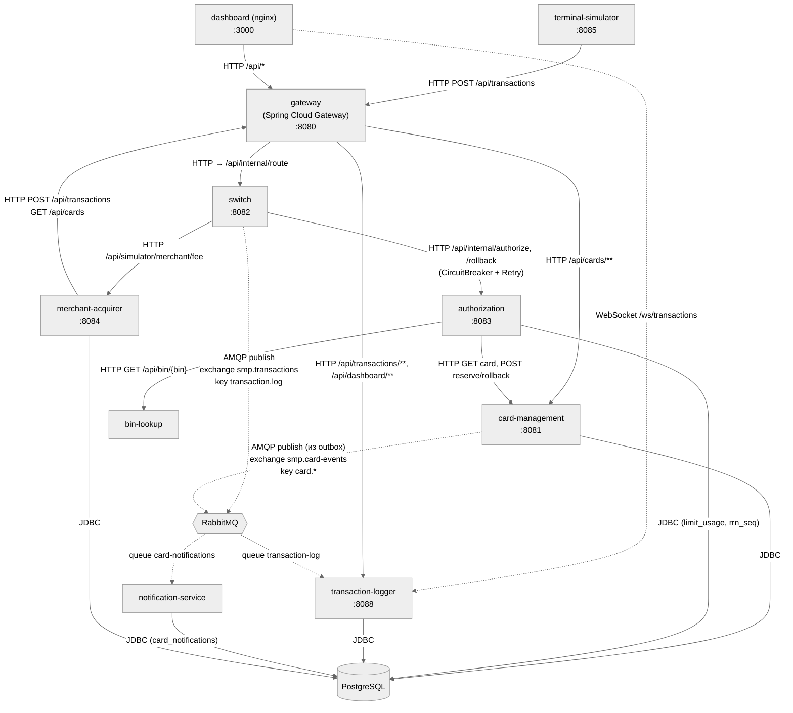

# A2. C4 Container — сервисы, БД, брокер

Сплошная стрелка = синхронно (HTTP/JDBC).
Пунктир = асинхронно (AMQP через RabbitMQ).

## Что на схеме и чем это подтверждено

| Утверждение | Код |
|---|---|
| Маршруты Gateway: `/api/transactions` (POST) → switch с `RewritePath` на `/api/internal/route`; `/api/transactions/**`, `/api/dashboard/**` → logger; `/api/cards/**` → card-management; `/api/simulator/*` → симуляторы | [gateway `application.yml`](../../../services/gateway/src/main/resources/application.yml) |
| Switch → Authorization синхронно, с CircuitBreaker и Retry (3 попытки, backoff 1/2/4 с; окно 10, порог 50 %, open 30 с) | [`AuthorizationClient`](../../../services/switch/src/main/java/com/processing/service/AuthorizationClient.java), [switch `application.yml`](../../../services/switch/src/main/resources/application.yml) |
| Switch → Merchant-Acquirer за комиссией; при сбое `null` (запрос не падает) | [`MerchantAcquirerClient`](../../../services/switch/src/main/java/com/processing/service/MerchantAcquirerClient.java) |
| Switch → RabbitMQ: exchange `smp.transactions` (topic), key `transaction.log` | [`LoggerClient`](../../../services/switch/src/main/java/com/processing/service/LoggerClient.java), [`RabbitMQConfig` (switch)](../../../services/switch/src/main/java/com/processing/config/RabbitMQConfig.java) |
| Logger читает очередь `transaction-log` и пишет в БД | [`TransactionLogListener`](../../../services/transaction-logger/src/main/java/com/processing/transactionlogger/listener/TransactionLogListener.java), [`TransactionService`](../../../services/transaction-logger/src/main/java/com/processing/transactionlogger/service/TransactionService.java) |
| Дашборд получает обновления по WebSocket напрямую из Logger (минуя Gateway) | [`dashboard/nginx.conf`](../../../services/dashboard/nginx.conf), [`WebSocketConfig`](../../../services/transaction-logger/src/main/java/com/processing/transactionlogger/websocket/WebSocketConfig.java) |
| Authorization ходит в Card-Management по HTTP и в Bin Lookup по HTTP | [`CardManagementClientImpl`](../../../services/authorization/src/main/java/com/processing/authorization/client/CardManagementClientImpl.java), [`BinLookupClient`](../../../services/authorization/src/main/java/com/processing/authorization/client/BinLookupClient.java) |
| Card-Management публикует события не напрямую, а через **outbox** (таблица → фоновый процессор → RabbitMQ), exchange `smp.card-events`, key `card.<ИмяСобытия>` | [`OutboxEventProcessorImpl`](../../../services/card-management/src/main/java/com/processing/cardmanagement/services/OutboxEventProcessorImpl.java), [`RabbitMQConfig` (cms)](../../../services/card-management/src/main/java/com/processing/cardmanagement/config/RabbitMQConfig.java) |
| Notification читает `card-notifications` и сохраняет в `card_notifications` | [`CardEventListener`](../../../services/notification-service/src/main/java/com/processing/notification/listener/CardEventListener.java) |
| С Postgres работают 5 сервисов: card-management, authorization, notification-service, merchant-acquirer, transaction-logger | [`docker-compose.yaml`](../../../docker-compose.yaml) (переменные `POSTGRES_*`) |

## Чего не хватало в проекте и что сделано

- В `docs/architecture.md` написано «11 сервисов» и «Postgres используют 4 сервиса». По `docker-compose.yaml` — 10 прикладных контейнеров и 5 потребителей БД. На схеме нарисовано **по compose**, а не по тексту документации.
- В документации не было видно, что дашборд ходит в Logger по WebSocket **мимо Gateway** — показано явно (nginx `/ws/`).
- Не было явной разметки sync/async. Добавлено: две асинхронные цепочки — `Switch → Logger` (журнал транзакций) и `Card-Management → Notification` (события карт).
- Вывод для пирамиды: в системе только **две** асинхронные границы, обе проверяются интеграционно/сквозным тестом с реальным брокером; модульными тестами с моками их надёжность не доказать.
