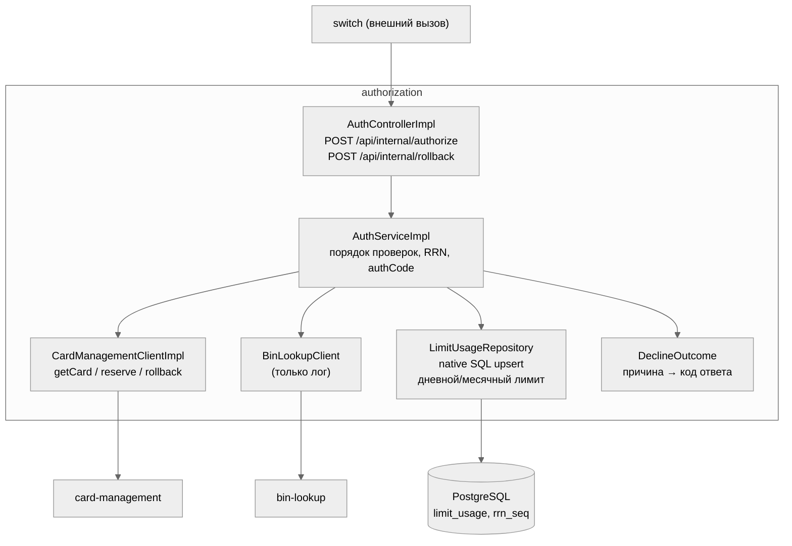
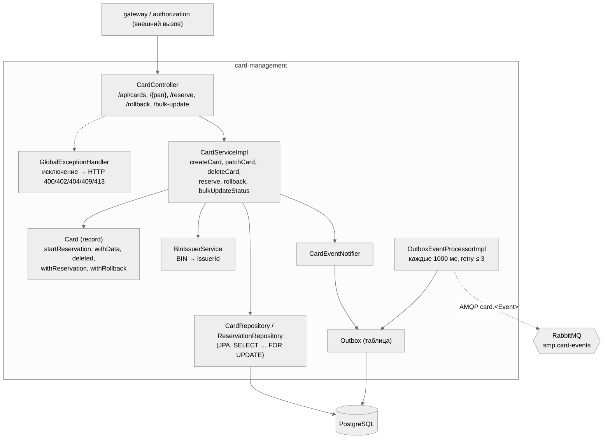

# A3. C4 Component — Authorization и Card-Management

Сплошная стрелка — синхронный вызов.
Пунктир — асинхронный (через брокер).

## 3.1 Authorization

**Порядок проверок в `AuthServiceImpl.authorize`** (определяет, на каком уровне что тестировать):
`getCard` → Bin Lookup (только лог) → статус карты → срок действия → баланс → `upsertLimitUsage` (суточный/месячный лимит) → RRN из `rrn_seq` (формат `%1d%03d%08d`) → `reserve` в Card-Management → authCode → `approved`.

| Утверждение | Код |
|---|---|
| Контроллер переводит причину отказа в HTTP-статус (CARD_NOT_FOUND→404, INSUFFICIENT_FUNDS→422, EXPIRED/BLOCKED/INACTIVE→403, SERVICE_UNAVAILABLE/RESERVATION_FAILED→503, прочее→400) | [`AuthControllerImpl`](../../../services/authorization/src/main/java/com/processing/authorization/controller/AuthControllerImpl.java) |
| Порядок проверок и вызовы клиента | [`AuthServiceImpl`](../../../services/authorization/src/main/java/com/processing/authorization/services/AuthServiceImpl.java) |
| Лимиты считаются атомарно в SQL (`INSERT … ON CONFLICT … DO UPDATE` с проверкой дневного/месячного) | [`LimitUsageRepository`](../../../services/authorization/src/main/java/com/processing/authorization/repositories/LimitUsageRepository.java) |
| Коды ответа (`05/14/51/54/61/96`) | [`DeclineOutcome`](../../../services/authorization/src/main/java/com/processing/authorization/constants/DeclineOutcome.java) |
| Card-Management вызывается по REST: `GET /api/cards/{pan}`, `POST …/reserve`, `POST …/rollback` | [`CardManagementClientImpl`](../../../services/authorization/src/main/java/com/processing/authorization/client/CardManagementClientImpl.java) |
| Bin Lookup: сбой не ломает авторизацию | [`BinLookupClient`](../../../services/authorization/src/main/java/com/processing/authorization/client/BinLookupClient.java) |

## 3.2 Card-Management

| Утверждение | Код |
|---|---|
| Эндпоинты `/api/cards` (POST, GET с `limit/offset/status/bin/issuerId/startDate/endDate`, GET/PATCH/DELETE `/{pan}`, `/reserve`, `/rollback`, `/bulk-update`) | [`CardController`](../../../services/card-management/src/main/java/com/processing/cardmanagement/controllers/CardController.java) |
| Бизнес-правила: резерв только для ACTIVE и при достаточном балансе; отрицательные лимиты и «месячный < дневного» → `IllegalArgumentException` | [`Card`](../../../services/card-management/src/main/java/com/processing/cardmanagement/models/Card.java) |
| Резерв идемпотентен по паре (rrn, pan), строки карты блокируются `FOR UPDATE` | [`CardServiceImpl.reserve/rollback`](../../../services/card-management/src/main/java/com/processing/cardmanagement/services/CardServiceImpl.java) |
| Событие кладётся в outbox вместе с изменением карты, отправляется отдельным процессом | [`CardEventNotifierImpl`](../../../services/card-management/src/main/java/com/processing/cardmanagement/events/CardEventNotifierImpl.java), [`OutboxEventProcessorImpl`](../../../services/card-management/src/main/java/com/processing/cardmanagement/services/OutboxEventProcessorImpl.java) |
| Состояния outbox: PENDING / PROCESSED / FAILED; FAILED после `retryCount >= max-retry-count (3)` | [`OutboxEventDataStatus`](../../../services/card-management/src/main/java/com/processing/cardmanagement/models/OutboxEventDataStatus.java) |
| Сопоставление исключений и HTTP-статусов | [`GlobalExceptionHandler`](../../../services/card-management/src/main/java/com/processing/cardmanagement/configuration/GlobalExceptionHandler.java) |

## Чего не хватало в проекте и что сделано

- Нигде не было описано **порядка проверок** в авторизации — а он определяет приоритет отказов (например, заблокированная карта с нулевым балансом получит `05`, а не `51`). Порядок восстановлен по коду и вынесен в диаграмму; от него зависят ожидаемые результаты тест-кейсов.
- Нигде не сказано, что проверка «дневной лимит ≤ месячный» есть только в `Card.withData` (PATCH и bulk-update), а при создании карты (`createCard` → `Card.fromDraft`) её нет. Это пробел в валидации, обнаруженный при чтении кода: тест-кейс на него — в `test-cases.md`.
- Логика лимитов вынесена в SQL: проверить её юнит-тестом с моком нельзя, нужен реальный PostgreSQL (интеграционный уровень).
