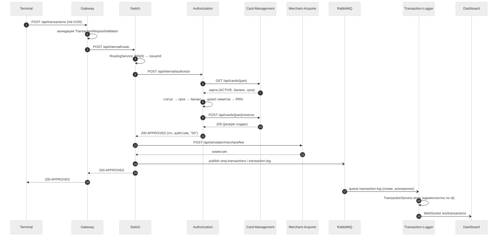
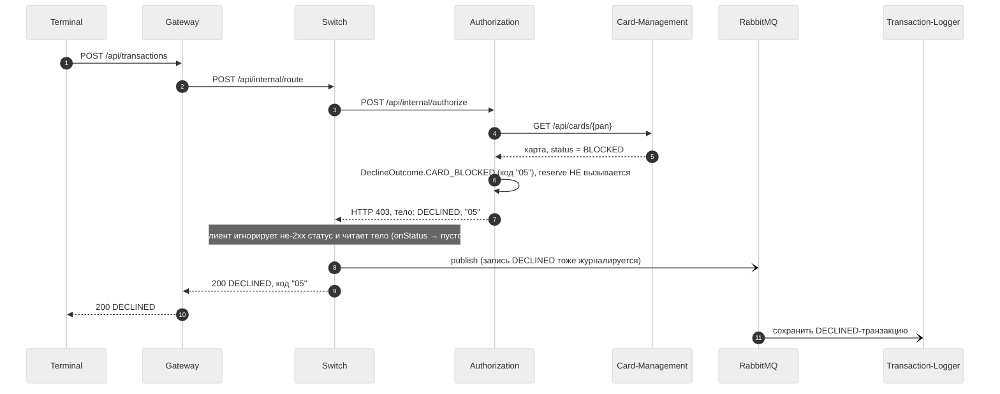
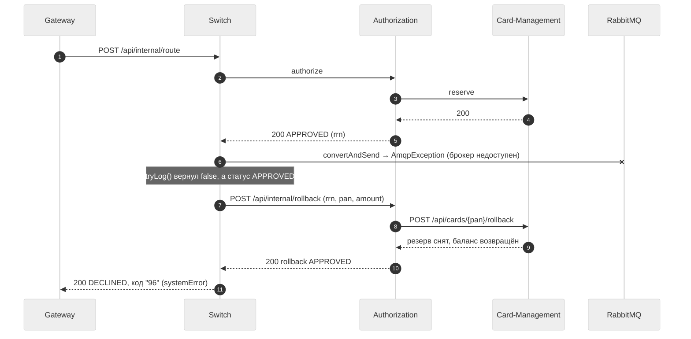

# A4. Sequence — три сценария

`->>` — синхронный вызов (HTTP).
`-)` — асинхронная отправка (AMQP).

## Сценарий 1. Успешная авторизация (happy path)

## Сценарий 2. Отказ: карта BLOCKED

## Сценарий 3. Откат резерва (RabbitMQ недоступен)

| Утверждение | Код |
|---|---|
| Валидация на входе | [`TransactionRequestValidator`](../../../services/gateway/src/main/java/com/processing/gateway/validation/TransactionRequestValidator.java) |
| Оркестрация: BIN → authorize → fee → журнал → откат при `!logged && APPROVED` | [`RouteService`](../../../services/switch/src/main/java/com/processing/service/RouteService.java) |
| Не-2xx ответы Authorization не бросают исключение, тело читается (`onStatus(... {})`) | [`AuthorizationClient`](../../../services/switch/src/main/java/com/processing/service/AuthorizationClient.java) |
| Статус 403 для BLOCKED, код `05` | [`AuthControllerImpl`](../../../services/authorization/src/main/java/com/processing/authorization/controller/AuthControllerImpl.java), [`DeclineOutcome`](../../../services/authorization/src/main/java/com/processing/authorization/constants/DeclineOutcome.java) |
| Резерв и откат в Card-Management | [`CardServiceImpl.reserve/rollback`](../../../services/card-management/src/main/java/com/processing/cardmanagement/services/CardServiceImpl.java) |
| Публикация в брокер | [`LoggerClient`](../../../services/switch/src/main/java/com/processing/service/LoggerClient.java) |
| Приём и запись; WebSocket | [`TransactionLogListener`](../../../services/transaction-logger/src/main/java/com/processing/transactionlogger/listener/TransactionLogListener.java), [`TransactionService`](../../../services/transaction-logger/src/main/java/com/processing/transactionlogger/service/TransactionService.java), [`WebSocketManager`](../../../services/transaction-logger/src/main/java/com/processing/transactionlogger/websocket/WebSocketManager.java) |
| Существующий e2e-тест на откат (TC-23) | [`RabbitMQAsyncE2eTest`](../../../services/e2e-tests/src/test/java/com/processing/e2e/tests/RabbitMQAsyncE2eTest.java) |

## Чего не хватало в проекте и что сделано

- **Расхождение документации и кода (главное).** В [`docs/architecture.md`](../../../docs/architecture.md) сказано, что Switch ждёт publisher-confirm до 2 секунд и при его отсутствии шлёт откат сообщением `mti 0400`. В коде этого нет: `LoggerClient` вызывает обычный `rabbitTemplate.convertAndSend`, `false` возвращается только при `AmqpException`; ожидания confirm нет; откат идёт через REST `/api/internal/rollback`. Фабрика `AuthorizationRequest.forReversal` (mti `0400`) нигде не вызывается. На диаграмме нарисовано **то, что делает код**.
- Следствие: если брокер принял сообщение, но не подтвердил (или потерял) его, а исключения нет — резерв **не** откатится, а транзакция не попадёт в журнал. Этот риск закрывается только интеграционным тестом с реальным брокером; в тест-кейсах он описан отдельно.
- В документации не сказано, что отказы (`DECLINED`) тоже журналируются и что неизвестный BIN (код `14`) и недоступность Authorization (код `05`) возвращаются как `200 DECLINED` из Switch, а не как HTTP-ошибки.
