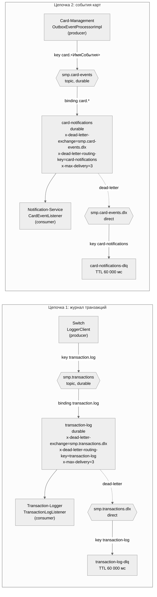

# A5. Топология RabbitMQ — exchange → queue → consumer

## Подтверждение по коду

| Элемент | Код |
|---|---|
| Producer 1: `convertAndSend(EXCHANGE, ROUTING_KEY, tx)`; `false` только при `AmqpException` | [`LoggerClient`](../../../services/switch/src/main/java/com/processing/service/LoggerClient.java) |
| Объявление exchange, очереди, DLX, DLQ (TTL 60 000) | [`RabbitMQConfig` (switch)](../../../services/switch/src/main/java/com/processing/config/RabbitMQConfig.java) |
| Настройки: `publisher-confirm-type: correlated`, `publisher-returns: true` | [switch `application.yml`](../../../services/switch/src/main/resources/application.yml) |
| Consumer 1: `@RabbitListener(queues = "transaction-log")` → `TransactionService.store` (идемпотентно по id; при конфликте `TransactionConflictException`) | [`TransactionLogListener`](../../../services/transaction-logger/src/main/java/com/processing/transactionlogger/listener/TransactionLogListener.java), [`TransactionService`](../../../services/transaction-logger/src/main/java/com/processing/transactionlogger/service/TransactionService.java) |
| Logger повторно объявляет exchange, очередь и binding; **DLX и DLQ у себя не объявляет** (только константы) | [`RabbitMQConfig` (logger)](../../../services/transaction-logger/src/main/java/com/processing/transactionlogger/config/RabbitMQConfig.java) |
| Producer 2: outbox → `card.<ИмяКласса>`; при ошибке `retryCount++`, FAILED при `>= 3` | [`OutboxEventProcessorImpl`](../../../services/card-management/src/main/java/com/processing/cardmanagement/services/OutboxEventProcessorImpl.java) |
| Топология карточных событий | [`RabbitMQConfig` (cms)](../../../services/card-management/src/main/java/com/processing/cardmanagement/config/RabbitMQConfig.java) |
| Consumer 2: `@RabbitListener(queues="card-notifications")`, `@Transactional`, при ошибке `RuntimeException` пробрасывается | [`CardEventListener`](../../../services/notification-service/src/main/java/com/processing/notification/listener/CardEventListener.java), [`RabbitMQConfig` (notification)](../../../services/notification-service/src/main/java/com/processing/notification/config/RabbitMQConfig.java) |
| Уже существующие e2e-тесты по этой теме | [`RabbitMQAsyncE2eTest`](../../../services/e2e-tests/src/test/java/com/processing/e2e/tests/RabbitMQAsyncE2eTest.java), [`NotificationServiceE2eTest`](../../../services/e2e-tests/src/test/java/com/processing/e2e/tests/NotificationServiceE2eTest.java) |

## Чего не хватало в проекте и что сделано

1. **Publisher confirms не используются в Switch.** Настройка `publisher-confirm-type: correlated` включена, но обработчика подтверждений и ожидания нет (`LoggerClient`), а в [`docs/architecture.md`](../../../docs/architecture.md) заявлено «ждём confirm 2 с». Фактическая гарантия доставки слабее документированной. На схеме confirm **не нарисован**, потому что в коде его нет.
2. **Параметр `x-max-delivery` — под вопросом.** В документации RabbitMQ такого аргумента очереди нет (для quorum-очередей существует `x-delivery-limit`). Поэтому утверждение «после 3 попыток сообщение уходит в DLX» **не подтверждено кодом и не проверено**. Возможное поведение: при исключении в listener Spring AMQP возвращает сообщение в очередь (`default-requeue-rejected = true`) и оно крутится бесконечно. Проверять надо интеграционным тестом с настоящим брокером (см. `test-cases.md`).
3. **Retry на стороне consumer не настроен**: в `application.yaml` Logger нет `spring.rabbitmq.listener.simple.retry`. «Retry 3 раза» из документации относится только к outbox-процессору в Card-Management и к HTTP-вызовам Switch → Authorization, а не к потребителям.
4. **DLX/DLQ цепочки 1 создаёт только Switch.** Если Logger запустится первым, очередь `transaction-log` будет иметь `x-dead-letter-exchange`, указывающий на ещё не существующий exchange: dead-letter тогда молча теряется до старта Switch. Для цепочки 2 DLX/DLQ объявляют и Card-Management, и Notification.
5. В документации нет схемы очередей вообще, только прозаическое описание.
