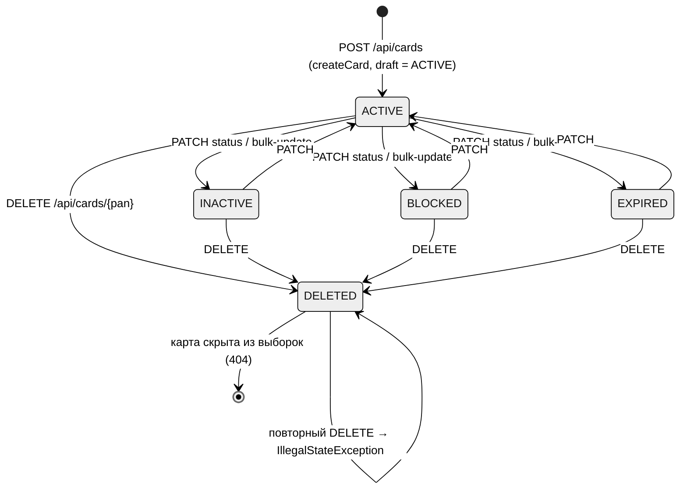
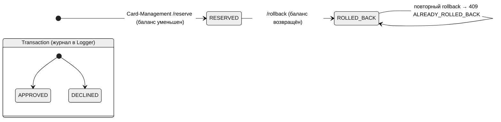
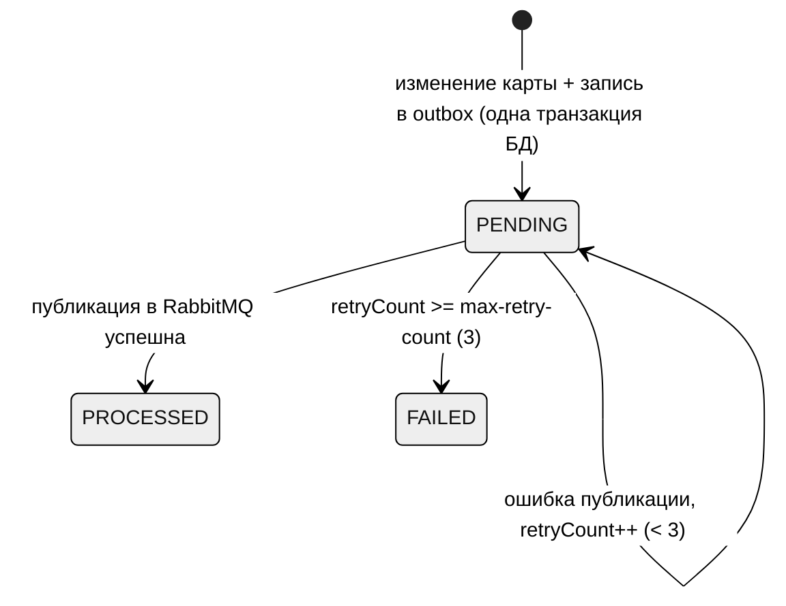

# A6. Диаграммы состояний

## 6.1 Card.status (Card-Management)

Правила, по которым нарисованы переходы:

- Резерв средств возможен только из `ACTIVE`: `Card.startReservation` → `checkStatusOrThrow` ([`Card`](../../../services/card-management/src/main/java/com/processing/cardmanagement/models/Card.java)).
- `DELETED` нельзя установить через PATCH (маппер статусов бросает исключение), только через DELETE ([`CardStatusMapper`](../../../services/card-management/src/main/java/com/processing/cardmanagement/mappers/CardStatusMapper.java), [`Card.deleted()`](../../../services/card-management/src/main/java/com/processing/cardmanagement/models/Card.java)).
- Удалённая карта не читается: `@SQLRestriction("status <> 'DELETED'")` ([`CardEntity`](../../../services/card-management/src/main/java/com/processing/cardmanagement/models/CardEntity.java)) → `GET /api/cards/{pan}` даёт 404.
- Ограничений на переходы между `ACTIVE/INACTIVE/BLOCKED/EXPIRED` в коде нет (любой → любой через `withData`). Если в требованиях подразумеваются запреты (например, `EXPIRED → ACTIVE`), система их **не обеспечивает**.
- Помимо статуса `EXPIRED`, срок проверяется по дате: карта действительна до конца месяца `expiryDate`; позже — отказ `54` ([`AuthServiceImpl`](../../../services/authorization/src/main/java/com/processing/authorization/services/AuthServiceImpl.java), строки ~107–111). То есть «просрочена» может быть карта со статусом `ACTIVE`.

## 6.2 Резерв и транзакция

- `ReservationStatus { RESERVED, ROLLED_BACK }`; повтор `reserve` с тем же (rrn, pan) → `ReservationAlreadyExistsException`; `rollback` по несуществующему (rrn, pan) → `ReservationNotFoundException` ([`CardServiceImpl`](../../../services/card-management/src/main/java/com/processing/cardmanagement/services/CardServiceImpl.java)).
- В журнале у транзакции только два статуса: `TransactionStatus { APPROVED, DECLINED }`. Состояния «откатана» **нет**: при откате резерва из-за сбоя брокера транзакция вообще не попадает в журнал (она не опубликована), а клиент получает `DECLINED / 96` ([`RouteService`](../../../services/switch/src/main/java/com/processing/service/RouteService.java)).

## 6.3 Событие в outbox (Card-Management)

Код: [`OutboxEventDataStatus`](../../../services/card-management/src/main/java/com/processing/cardmanagement/models/OutboxEventDataStatus.java), [`OutboxEventProcessorImpl`](../../../services/card-management/src/main/java/com/processing/cardmanagement/services/OutboxEventProcessorImpl.java) (опрос раз в 1000 мс).

## Чего не хватало в проекте и что сделано

- В документации нет ни одной диаграммы состояний. Восстановлены по enum-ам и методам модели.
- Выявлены разрывы между «логикой» и кодом, которые стоит проверять тестами: (1) нет таблицы допустимых переходов статуса карты; (2) у транзакции нет статуса отката; (3) «просрочена» определяется двумя независимыми механизмами (статус и дата).
